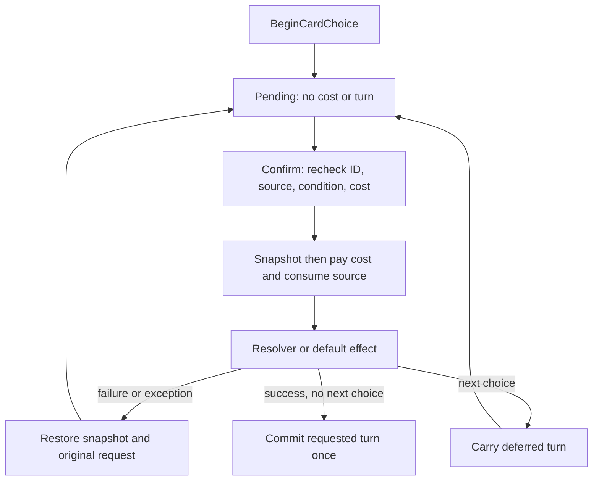

# Card choices: fields, settlement and saves

[简体中文](../../zh-CN/reference/card-choice.md) · [Index](../README.md)

Guide revision 6 · Mod API 1.10.0 · 2026-10-17


This contract follows current `CardChoiceModels.cs`, `CardChoiceEventContent.cs` and `GameEngine.CardChoices.cs` for the formal battle scene with the new card-choice overlay. Start with the [two-branch lesson](../tutorials/card-choice.md); declarations are in the [API index](api-surface.md).

## Entry points and identity

Rules call `GameEngine.BeginCardChoice(CardChoiceRequest)`; the game's UI adapter calls `GameplayUiAdapter.BeginCardChoice`. Third-party content should use `CardChoiceEventContent` or its execution context, without accessing scene components. Confirm with `ResolveCardChoice(choiceId, choiceIndex)` and cancel with `CancelCardChoice(choiceId)`. The index is zero-based in the full options list, not within the current page. Compatible `ResolvePendingChoice(index)` applies to the current request only.

Opening generates a fresh `pendingChoice.choiceId`. Old IDs, repeated clicks and calls during resolution are rejected. An existing choice, pending preparation or a battle that cannot accept actions prevents opening a replacement. The request deep-copies options, cards, effects and costs; later template changes do not change the pending snapshot.

Opening creates pending state only. Confirmation pays and resolves; failure restores this step.



## Request fields

| Field / default | Meaning and limits |
| --- | --- |
| `title = ""` | Direct header and fallback; without text or a localization source, the entire header is hidden |
| `titleContentId = ""` | Content name, ahead of the title key and direct text; the event base uses its own ID |
| `titleLocalizationKey = ""` | Host title localization key, below the content name; a package ModText key is not automatically a host key |
| `options` | Nonempty list; every entry needs a nonempty unique `id` and non-null `card`; no three-option cap |
| `resolverContentId = ""` | Empty automatically applies the selected effect; otherwise a registered `ICardChoiceResolver` owns the reward |
| `sourceColumn = -1`, `sourceCardId = ""` | Source column index and source-card instance ID, not content ID |
| `consumeSource = false` | Requires the original source to remain exposed in that column; removes only that card on confirmation |
| `consumeTurn = false` | Commits after success; a next choice or existing reward defers it |
| `allowCancel = false` | Cancelling an optional initial request charges no cost or turn |
| `commitTurnOnCancel = false` | Engine handoff marker for a chain; do not use it to waive an earlier step's turn obligation |

`CardChoiceEventContent` changes these defaults: the event name is the title, the clicked event is the source, both `consumeSource` and `consumeTurn` are true, and its own resolver is specified. An omitted title in an ordinary request does not insert a default title. Empty, null or whitespace-only direct titles also hide the header if there is no localization source.

## Option fields

| Field / default | Meaning |
| --- | --- |
| `id = ""` | Stable branch identifier, read as `context.Selected.id` |
| `card` | Real card-face preview; does not execute its original click, drag or purchase behavior |
| `effect = null` | Attribute reward; positive hp uses the full healing pipeline |
| `cost = null` | Positive attributes mean spending; HP and max HP must leave at least 1 |
| `conditionExpression = ""` | Empty passes; see the limited [condition grammar](conditions.md) |
| `enabled = true` | Explicit author switch; availability also requires the condition and affordability |
| `maxHpGainDoesNotHeal = false` | True makes a max-HP reward raise only the cap |

Conditions and affordability are checked for display and confirmation. Disabled options remain visible, faded and unclickable. If all options are unavailable at opening, `no_available_card_choice` creates no request. Do not use disabled branches to trap the player in a story.

## Specialized effects and chains

`ICardChoiceResolver` must be concrete content found in the current registry. `context.Runtime` provides shared healing, shield and damage settlement; `context.ApplyEffect` applies attribute data; `context.State` is current state, and `context.Request` / `Selected` describe this resolution. There is no `StatEffect.shield`; use `context.Runtime.AddShield`.

Confirmation runs: recheck → snapshot → temporarily clear pending → pay option cost → consume source → call resolver or default effect → hand off to another choice/reward or commit. Resolvers must not end turns, switch scenes, mutate static objects or write external files themselves.

Inside an existing resolver, open the next step and return its result:

```csharp
return context.OpenNext(nextRequest);
```

`nextRequest` must already be valid. The earlier turn obligation carries forward; final completion commits once. Cancelling the next step does not reverse earlier successful effects or costs, and still commits that turn. If the first step consumed its source, the next cannot consume the same old card again. Apply this step's own reward before returning OpenNext; an opening failure rolls back this step.

## Failure and saves

If a resolver fails, returns null or throws, the engine restores the pre-step snapshot and random state, including cost, source, effects and original pending request, allowing retry. Rollback covers engine state only, not external side effects. Saves retain a stable resolver ID, not a delegate; the content must still be registered when restored. Anonymous in-memory callbacks are not save resolvers.

A replaced source, a missing resolver after restore or all branches becoming unavailable enables escape cancellation even when `allowCancel` is false. Normalization clears damaged empty requests. Existing presentation sequences play before the overlay appears. Any number of options is paged according to the existing slot capacity; scripts do not rearrange authored scene cards.

## Diagnostics and acceptance

| code | First check |
| --- | --- |
| `invalid_card_choices` | Empty list, null card, empty or duplicate option.id |
| `choice_pending` | An earlier choice remains unresolved |
| `missing_card_choice_resolver` | Registered ID and implemented interface |
| `card_choice_source_changed` | Column, instance ID and exposed source |
| `card_choice_unavailable` | enabled, condition and current resources |
| `stale_card_choice` | Submission carries the current request ID |
| `card_choice_effect_failed` | Exception/null resolver result; verify snapshot restoration |
| `card_choice_cannot_cancel` | Valid mandatory request or stale request ID |

Check two and seven cards; free and paid branches; insufficient resources; repeated clicks; blank and content titles; mid-choice save/restore; missing-resolver escape; failure/exception rollback; and two-step confirmation/cancellation committing one turn each. Choose checks relevant to your changes and try them in the game. See [versions](versions.md) for current limitations.
