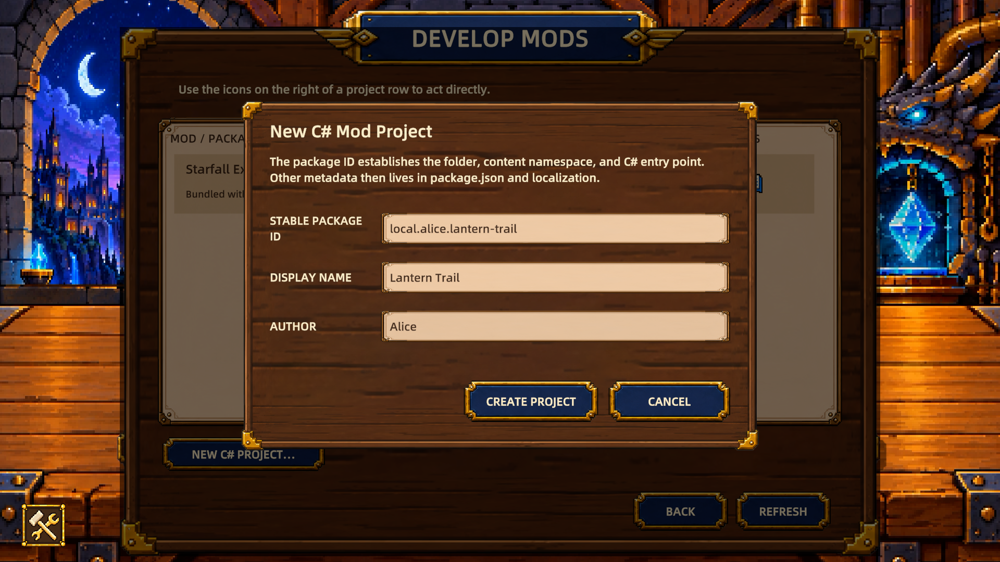
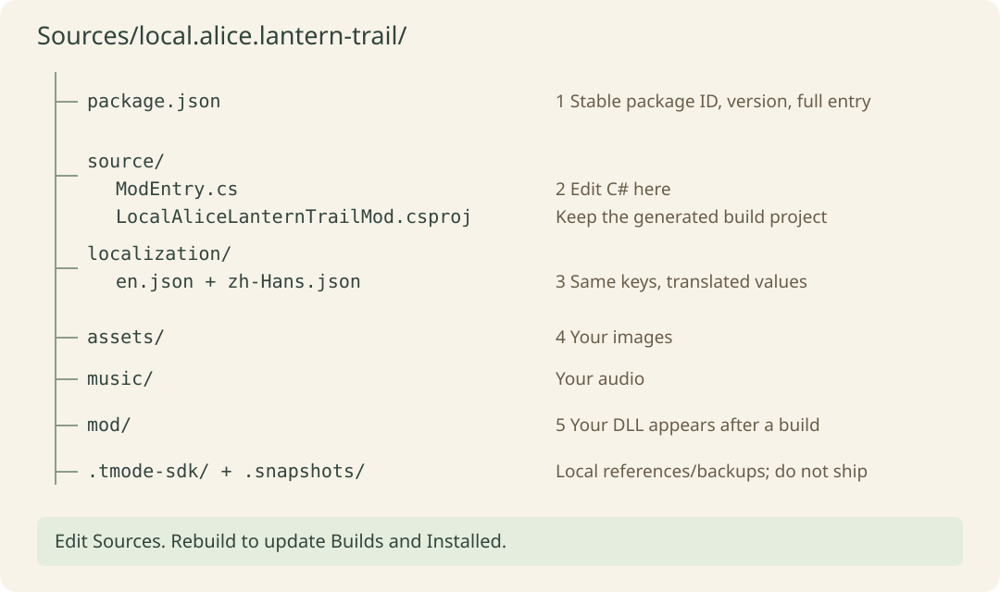
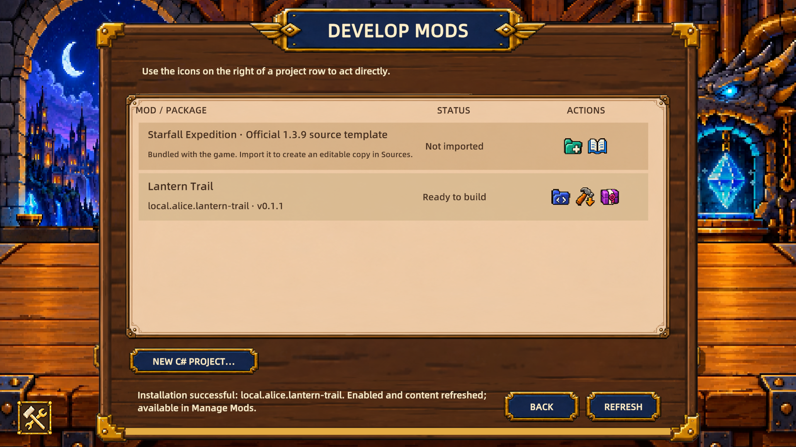
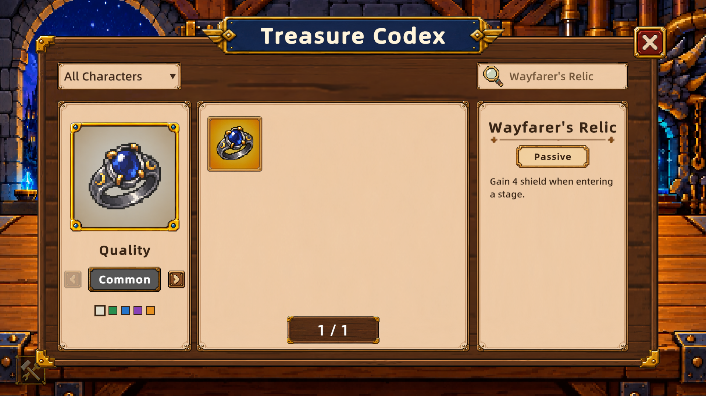
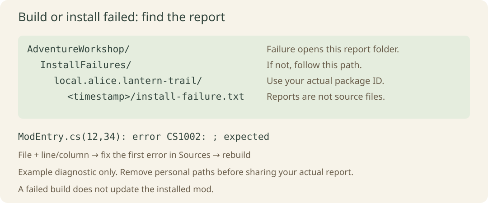
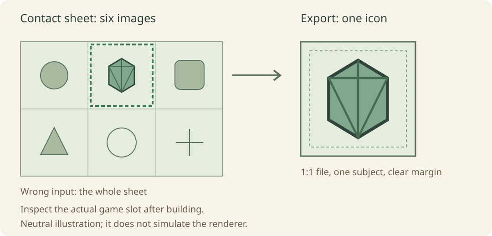

# Screenshots and file locations

[简体中文](../../zh-CN/reference/visual-walkthrough.md) · [Index](../README.md)

Guide revision 2 · Mod API 1.8.0 · 2026-10-14

Screenshots show the actual English UI in the official project. Creation and building use an isolated documentation workspace and real services. Buttons, layout, and text are unchanged; the user's existing projects are excluded. These images identify operations and do not replace a full standalone-game restart. Alice is a teaching name; enter your own name as author.

## 1. Open the workshop

Use the crossed-tools button at the lower left of the main menu. The middle **Develop Mods → Open** row opens development; **Manage Mods** handles installation and enabling. The first lesson does not require importing the official adventure example.

## 2. Create and open source

Enter `local.alice.lantern-trail` as **Stable Package ID**. **Display Name** is the displayed name. Choose **Create Project**; the success dialog gives your local project location. If the ID exists, choose another and check the generated namespace against the manifest entry.

This diagram follows the actual generated directory; it is not a File Explorer screenshot or a complete file list. The blue source-folder icon opens `Sources/<packageId>`; the hammer with a down arrow builds and installs; the rightmost package icon opens release preparation. Edit `source/ModEntry.cs`, keep the generated csproj, and do not edit source in Builds or Installed.

## 3. Check the build result

This build uses the [first lesson](../tutorials/first-mod.md) change to 4 and version `0.1.1`. **Installation successful** at the bottom confirms installation. **Ready to build** on the row only describes source build-entry conditions; it neither detects the SDK nor verifies gameplay. Fully exit and restart, then check the level-1 description in the codex.

Open **Codex → Treasures** from the main menu, choose **All Characters**, search for `Wayfarer's Relic`, and select the result. This screenshot selects Common in the actual loaded content; the default may be the highest available quality. All qualities share the level-1 value of 4 in this lesson. The quality arrows do not upgrade a treasure. This lesson binds no custom art; the icon identifies the result and is not an asset you must supply.

## 4. Find an error report

On failure, the game attempts to open the report folder. If that fails, follow the workshop-root path, your package ID, and the actual timestamp to `install-failure.txt`. CS1002 only illustrates file, line/column, and error syntax; use your own first error. See [Troubleshooting](../troubleshooting.md), and remove private absolute paths before sharing.

## 5. Export only the intended icon

The six-cell sheet is not one treasure icon. Export the intended image separately in your drawing tool with a reasonable margin. This is a neutral illustration, not a game rendering. After binding, inspect the subject, transparent edges, and proportions in the actual codex and board; see the [assets lesson](../tutorials/assets-and-text.md).
