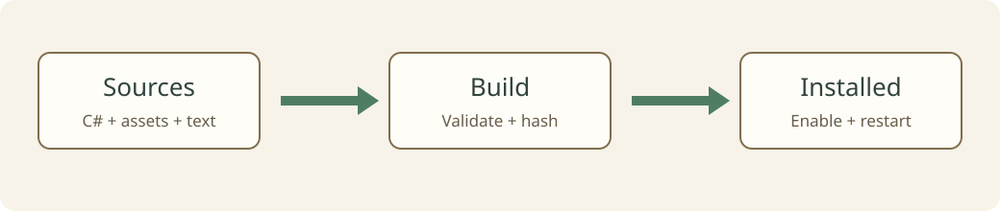

# Package, publish, and update

[简体中文](../../zh-CN/tutorials/publish.md) · [Index](../README.md)

Guide revision 4 · Mod API 1.8.0 · 2026-10-14 · [Validation scope](../reference/versions.md)

Goal: build an installable package from verified Sources, complete release preparation, and distinguish Steam verification from a local export. This is a workflow; this guide rewrite does not publish a mod for you.

Prerequisite: complete the relevant gameplay and asset checks. Edit `package.json` version and release notes; fill release metadata and preview art in the game's preparation page.

## 1. Freeze the release candidate

Rebuild and install from Sources, then verify that exact version. Keep the package ID stable and update release notes when changing `version`. After C# changes, fully restart and begin a new run. Check selection, characters, key triggers, exits, failure, reset, save restoration, Chinese and English, and asset fallbacks.

See the [testing overview](../04-testing-and-publishing.md). Record build, real loading, gameplay, and untested areas separately. No compiler errors does not mean every check passed.

## 2. Inspect the package

The release contains `package.json`, your own `mod/*.dll`, localization, required images/index/music, and workshop-generated hashes. Exclude game API/Core references, `.tmode-sdk`, `source/bin`, `source/obj`, snapshots, private reports, and saves. Do not edit Builds or Installed directly; return to Sources and rebuild after any change.

A build hash describes exact file content. It does not authenticate the author or constitute a digital signature. Changed content changes the precise hash and trust confirmation. Code mods run with the game process's permissions; describe their purpose and required permissions accurately.

## 3. Use release preparation

Open release preparation from the development page, select the source/build, fill title, description, update notes, tags, and visibility, and supply a valid preview image. See the [publishing overview](../04-testing-and-publishing.md) for fields and update steps.

Run local preparation checks first and resolve asset and manifest diagnostics. If you only export a package, record an export result; that does not prove a Steam upload succeeded.

## 4. Verify online delivery separately

Submit in a release-capable game environment logged into Steam. If the workshop agreement is required, complete it on Steam and check the item's actual visibility. Reuse the existing item for updates and confirm version, preview, and notes agree.

Test the subscribed download: install, enable, fully restart, inspect content and languages, and play it. An installed local development version can conceal missing uploaded files, so check which source is actually loaded. Before save migration or old-version compatibility work, read [Versions](../reference/versions.md) and retain a recoverable record.

## Checks and next step

- The package contains only release files, passes hash validation, and loads after reinstallation.
- Version, entry, assets, and notes match verified gameplay.
- Export, online submission, item visibility, and subscribed download have separate evidence.

Use [Troubleshooting](../troubleshooting.md) for failures. Follow [Contributing](../../../CONTRIBUTING.md) when maintaining the bilingual guide.
