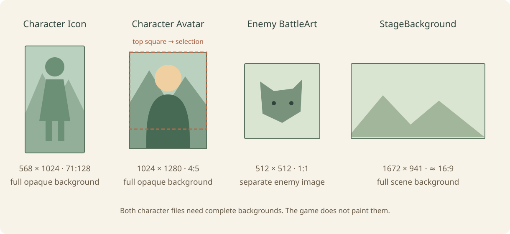

# 03 资源与表现

[English](../en/03-assets-and-presentation.md) · [教程目录](README.md)

教程修订 4 · 核对日期：2026-10-14 · Mod API：1.8.0。

第一次制作先读[首课](tutorials/first-mod.md)。本文是工程手册；按目标制作见[任务目录](README.md)。

本篇说明如何给 Mod 内容绑定图片、为关卡注册音乐、维护本地化文本，以及现有配置接口的兼容边界。

## 目录

1. 图片目录、格式和命名
2. 图片展示槽位与代码
3. 构建时的素材校验
4. C# Mod 关卡音乐
5. 音乐回退与当前限制
6. 本地化文本
7. 可配置参数

## 一、图片目录、格式和命名

```text
assets/icons/          宝物、技能、意图等小图标
assets/portraits/      角色立绘、角色头像、敌人战斗图
assets/backgrounds/    关卡背景、地图缩略图、抵达图
assets/_inbox/         临时导入区，不进入构建
```

支持 PNG、JPG、JPEG；单边最大 8192 像素。需要透明背景时使用 PNG。图标建议正方形并留安全边距；角色与敌人立绘避免主体贴边；背景按游戏画幅制作。

当前游戏推荐的素材尺寸如下：

| 用途 | 槽位/目录 | 推荐比例与尺寸 |
| --- | --- | --- |
| 角色主图（选人页和战斗主图） | `Icon` / `assets/icons` | 284×512（71:128）；这是角色主图，工坊封面另行制作 |
| 角色战斗头像 | `Avatar` / `assets/portraits` | 1:1，例如 1024×1024；用于选人页的小头像和状态栏裁切 |
| 角色状态立绘兼容槽 | `Portrait` / `assets/portraits` | 可选，建议与 `Icon` 同为 284×512；旧 UI 或状态显示需要时作为回退图 |
| 敌人战斗图 | `BattleArt` / `assets/portraits` | 1:1，推荐 512×512 或 1024×1024 |
| 宝物、招式、意图图标 | `Icon`、`IntentIcon` / `assets/icons` | 1:1，推荐 512×512 或更高 |
| 关卡背景 | `StageBackground` / `assets/backgrounds` | 16:9，例如 1672×941 |

如果用生成模型一次制作多个敌人或图标，可以先生成 3×2 素材表，再按单元格裁成六张方图。3×2 原图只放在项目的 `art-source` 或 `assets/_inbox`，最终代码只能引用裁切后的单张文件；不要把整张素材表直接绑定到 `BattleArt` 或 `Icon`。用图像工具按等大网格切片，切片后仍要检查主体没有贴边、六张图没有串格，并确认最终文件是有效 PNG。

文件名建议只使用小写英文、数字和连字符，例如 `amber-lantern.png`。代码中的相对路径必须与文件大小写完全一致。只改扩展名不会把其他格式变成真正的 PNG/JPG。



图中仅展示比例与像素规格，实际素材仍需在游戏里检查裁切和透明边距。

## 二、图片展示槽位与代码

内容类实现 `IModPresentationContent`，再返回对应槽位。

宝物或技能图标：

```csharp
public ModPresentation Presentation =>
    ModAssets.Icon("assets/icons/amber-lantern.png");
```

角色主图和头像：

```csharp
public ModPresentation Presentation => ModAssets.Create(
    (ModPresentationSlot.Icon, "assets/icons/lantern-ranger-icon.png"),
    (ModPresentationSlot.Avatar, "assets/portraits/lantern-ranger-avatar.png"),
    (ModPresentationSlot.Portrait, "assets/portraits/lantern-ranger-portrait.png"));
```

如果主图也要兼作旧界面的兼容立绘，可以让 `Icon` 和 `Portrait` 指向同一个文件，不需要复制：

```csharp
public ModPresentation Presentation => ModAssets.Create(
    (ModPresentationSlot.Icon, "assets/icons/mossfire-hunter.png"),
    (ModPresentationSlot.Portrait, "assets/icons/mossfire-hunter.png"),
    (ModPresentationSlot.Avatar, "assets/portraits/mossfire-hunter-avatar.png"));
```

敌人战斗图：

```csharp
public ModPresentation Presentation =>
    ModAssets.Enemy("assets/portraits/moss-wolf.png");
```

关卡背景、地图缩略图和抵达图：

```csharp
public ModPresentation Presentation => ModAssets.Stage(
    "assets/backgrounds/lantern-trail.png",
    "assets/backgrounds/lantern-map.png",
    "assets/backgrounds/lantern-arrival.png");
```

槽位与目录需要匹配：`Icon/IntentIcon` 使用 `icons`；`Portrait/Avatar/BattleArt` 通常使用 `portraits`；关卡三个槽位使用 `backgrounds`。兼容加载器也允许 `Portrait` 使用 `icons` 中已导入的 Icon 资源。角色选人页和战斗主图读取 `Icon`，因此只绑定 `Portrait` 会出现角色没有主图；`Portrait` 是可选兼容回退槽位。若主图也要作为回退图，把同一个 `assets/icons/...png` 路径同时绑定给 `Icon` 和 `Portrait`，素材索引只需导入这一个文件，不要复制。角色主图不要按普通 4:5 立绘制作，应按 284×512 高竖幅制作；头像仍建议单独提供 1:1 的 `Avatar`。路径只能指向包内文件，不能使用绝对路径或 `../`。

## 三、构建时的素材校验

“构建并安装”会验证图片头、真实格式、尺寸、大小与解码能力，并自动生成 `assets/asset-index.json`。不要手工编辑索引。

图片不显示时按顺序检查：文件是否位于标准目录；代码路径大小写是否一致；类是否实现展示接口；是否重新构建；索引是否自动生成；槽位是否与目录匹配；文件是否能被正常图片软件打开。

## 四、C# Mod 关卡音乐

当前 C# Mod 可以为自己的关卡注册音乐主题。文件放在：

```text
music/lantern-explore.ogg
music/lantern-boss.ogg
```

只接受包内 `.ogg` 或 `.wav`。长音乐推荐 OGG 以减小体积；WAV 体积较大。代码必须使用相对包根目录的路径。

注册主题：

```csharp
using System.Collections.Generic;
using MiniHero.ModApi;

public static class MusicIds
{
    public const string LanternTheme =
        ModEntry.PackageId + ".music.lantern_trail";
}

public override void Load(IModRegistrar registrar)
{
    registrar.AddMusicTheme(new ModMusicTheme(
        MusicIds.LanternTheme,
        new Dictionary<ModMusicCue, string>
        {
            [ModMusicCue.StageExplore] = "music/lantern-explore.ogg",
            [ModMusicCue.BossBattle] = "music/lantern-boss.ogg"
        }));

    registrar.AddContent(new LanternTrailStage());
}
```

音乐主题 ID 必须以包 ID 加点号开头，并且不能重复。然后在关卡定义中引用：

```csharp
return new StageDefinition
{
    id = Id,
    name = Name,
    subtitle = Subtitle,
    music = MusicIds.LanternTheme,
    boss = false,
    // 其他关卡字段……
};
```

Boss 关卡设置 `boss = true`。

## 五、音乐回退与当前限制

当前真正接通的关卡音乐槽位：

- `StageExplore`：普通关卡。未提供或 Mod 音频加载失败时，回退游戏内置的游戏内音乐列表。
- `BossBattle`：Boss 关卡；未提供或 Mod 音频加载失败时，先尝试同主题的 `StageExplore`；探索曲也缺失或加载失败，再回退游戏内置的游戏内音乐列表。

因此，主题只注册 `BossBattle` 并被普通关卡引用时，普通关卡不会静音，也不会播放 Boss 曲，而是回退游戏内置的游戏内音乐列表。若该列表没有可播放曲目，控制器会记录“游戏内音乐列表没有可播放的音乐”警告。Mod 音频文件存在但解码或请求失败时，也走相同回退路径，并会额外记录读取失败警告。

音乐槽位由当前展开战斗关卡的 `StageDefinition.boss` 选择。在完整冒险中，这个值由对应 `AdventureStepDefinition.boss` 和当前轮次生成；Boss 敌人的 `CardState.isBoss` 用来标记敌人卡，不会单独切换音乐。Boss 步骤通常需要同时有可生成的 `isBoss` 敌人卡，详见 `02-content-creation.md` 的 Boss 标记说明。

自定义 Mod 页面可以通过 `ModScreenDefinition.musicThemeId` 构造参数指定主题，宿主在页面打开时调用该主题的 `MainMenu` 曲目，关闭后恢复原菜单音乐。这与关卡音乐是两条入口：仅给关卡填写 `music` 不会替换原主菜单。`Victory` 仍未接通为 Mod 胜利页音乐，不应宣称它可用。

音乐播放继续受游戏全局音乐音量控制。场景中的 `BackgroundMusicController` 还具有“允许关卡音乐主题”和“Mod 音乐相对音量”两个制作参数。

音乐诊断：

- `MH_MOD_MUSIC_ID`：主题 ID 不属于本包或重复。
- `MH_MOD_MUSIC_ASSET`：文件不存在、路径逃出包目录或格式不是 OGG/WAV。
- 关卡提示主题不存在：注册 ID 与 `StageDefinition.music` 不一致。
- 修改后仍听到旧音乐：重新构建、安装并重载，必要时完整重启清除音频缓存。

## 六、本地化文本

```csharp
public override string Name => ModText.Get(
    ModEntry.PackageId,
    "treasure.amber_lantern.name",
    "琥珀提灯");

public override string Describe(int level) => ModText.Format(
    ModEntry.PackageId,
    "treasure.amber_lantern.description",
    "进入场景时获得 {0} 点护盾。",
    BaseValue * level);
```

对应 `localization/zh-Hans.json`：

这是显示文字表；宝物的触发与护盾公式仍写在 C# 内容类中。

```json
{
  "locale": "zh-Hans",
  "entries": [
    { "key": "treasure.amber_lantern.name", "value": "琥珀提灯" },
    { "key": "treasure.amber_lantern.description", "value": "进入场景时获得 {0} 点护盾。" }
  ]
}
```

第三个参数是找不到翻译时的后备文本，必须能独立阅读。增加英文时创建 `localization/en.json`，并在 `package.json` 的 `supportedLocales` 加入 `en`。

同一组键的英文条目如下；只合并这些条目，不覆盖已有翻译：

```json
{
  "locale": "en",
  "entries": [
    { "key": "treasure.amber_lantern.name", "value": "Amber Lantern" },
    { "key": "treasure.amber_lantern.description", "value": "Gain {0} shield when entering a stage." }
  ]
}
```

## 七、配置兼容入口

当前没有玩家 Mod 配置页。`AddConfig/ModConfig` 仅保留兼容能力，完整字段和限制见[兼容说明](reference/compatibility.md)。新手按源码默认值制作，不需要配置片段。
