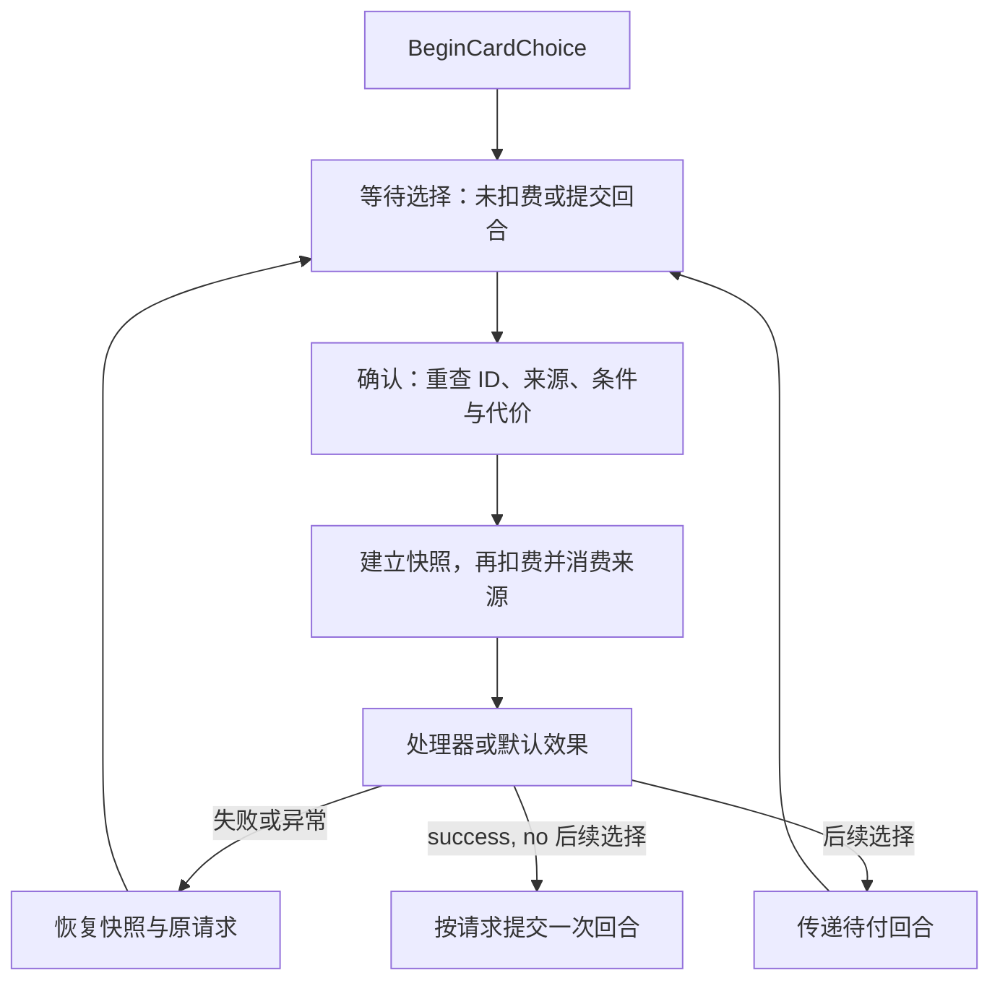

# 卡牌选择：字段、结算与存档契约

[English](../../en/reference/card-choice.md) · [Index](../README.md)

教程修订 5 · Mod API 1.8.0 · 2026-10-14


本页依据当前 `CardChoiceModels.cs`、`CardChoiceEventContent.cs` 和 `GameEngine.CardChoices.cs`，适用于已接入“新卡牌选择”的正式战斗场景。先做[双分支课](../tutorials/card-choice.md)，完整声明查[API 索引](api-surface.md)。

## 入口与身份

规则层用 `GameEngine.BeginCardChoice(CardChoiceRequest)`；游戏 UI 适配层用 `GameplayUiAdapter.BeginCardChoice`。第三方内容优先通过 `CardChoiceEventContent` 或具体内容的执行上下文调用引擎，不访问场景组件。确认使用 `ResolveCardChoice(choiceId, choiceIndex)`，取消使用 `CancelCardChoice(choiceId)`；index 是完整 options 列表的零基下标，分页时不能传页内下标。兼容的 `ResolvePendingChoice(index)` 只作用于当前请求。

每次打开生成新的 `pendingChoice.choiceId`。旧 ID、连点与结算中再次调用均被拒绝。正在选择、等待整备或未进入可操作战斗时不能覆盖打开。请求会深拷贝选项、卡面、收益和代价；打开后改原模板不会改变待选快照。

打开只创建等待状态；确认后才扣费和结算，失败恢复本步快照。



## 请求字段

| 字段／默认 | 意义与限制 |
| --- | --- |
| `title = ""` | 直接标头文本及后备文本；无文字和本地化来源时隐藏整个标头 |
| `titleContentId = ""` | 查询内容名称，优先于标题键和直接文本；事件基类使用自身 ID |
| `titleLocalizationKey = ""` | 宿主标题本地化键，次于内容名称；不要把包内 ModText 键当作自动可解析的宿主键 |
| `options` | 非空列表；每项必须有非空唯一 `id` 与非 null `card`；不设三项上限 |
| `resolverContentId = ""` | 空则自动应用所选 effect；非空须注册 `ICardChoiceResolver`，由具体内容处理收益 |
| `sourceColumn = -1`、`sourceCardId = ""` | 来源列下标与来源卡实例 ID；不是内容 ID |
| `consumeSource = false` | 为 true 必须来源仍在指定列最上方，确认时只移除该原卡 |
| `consumeTurn = false` | 成功后提交回合；有下一选择或既有奖励时延后提交 |
| `allowCancel = false` | 初始请求可取消时，取消不扣成本或回合 |
| `commitTurnOnCancel = false` | 连续选择的引擎交接标记；不要用它人为免除前一步应付回合 |

`CardChoiceEventContent` 覆盖默认值：标题使用事件名、来源使用点击的事件卡、`consumeSource` 和 `consumeTurn` 均为 true，并指定自身处理器。省略普通请求的标题不会自动补“选择卡牌”。空、null 或纯空白直接标题没有本地化来源时也隐藏标头。

## 选项字段

| 字段／默认 | 意义 |
| --- | --- |
| `id = ""` | 稳定分支语义标识，处理器读取 `context.Selected.id` |
| `card` | 正式卡面预览；不执行它原有点击／拖动／购买行为 |
| `effect = null` | 属性收益；正数 hp 使用完整治疗结算 |
| `cost = null` | 正数属性代表消耗；生命和最大生命必须至少保留 1 |
| `conditionExpression = ""` | 空表示满足；有限语法见[条件参考](conditions.md) |
| `enabled = true` | 作者显式禁用；可选性还须同时满足条件与支付能力 |
| `maxHpGainDoesNotHeal = false` | true 时最大生命收益只增加上限 |

条件、支付能力在显示和确认时均检查。禁用选项保留卡面、变淡且禁止点击。若打开时全部不可选，返回 `no_available_card_choice`，不创建请求。不要靠禁用全部分支制作不可退出的剧情。

## 专属处理与连续选择

`ICardChoiceResolver` 必须是当前注册表可找到的具体内容。`context.Runtime` 提供治疗、护盾和伤害等共享结算；`context.ApplyEffect` 按选项数据应用属性收益；`context.State` 是当前状态，`context.Request`／`Selected` 为本次处理数据。没有 `StatEffect.shield` 字段，护盾用 `context.Runtime.AddShield`。

确认顺序是重查 → 快照 → 暂时清除 pending → 扣选项代价 → 消费来源 → 调处理器或默认收益 → 交接下一选择／奖励或提交回合。处理器不能自行结束回合、切场景、改静态可变对象或外部文件。

在已有处理器内打开下一步并直接返回结果：

```csharp
return context.OpenNext(nextRequest);
```

`nextRequest` 必须已经按本页构造合法。前一步的回合义务传到下一步，最终一次提交。下一步取消不会撤回前一步已成功的收益或代价，并仍提交其应付回合。前一步已消费来源时，不能让下一步再次消费同一张旧卡。处理器同时实现续接与收益时，先完成自己的收益，再返回 OpenNext 的结果；打开失败将回滚本步。

## 失败与存档

处理器返回失败、null 或抛异常时，引擎恢复本步之前的游戏快照及随机数进度，包含代价、来源、收益和原 pending；可重试。回滚只覆盖引擎状态，不覆盖外部副作用。请求不存委托，保存处理器稳定 ID；重读时必须仍注册对应内容。切勿用匿名内存回调充当存档处理器。

来源被替换、读档后处理器缺失或所有分支失效时，即使 `allowCancel` 为 false，也提供逃生取消；损坏的空请求在规范化时清除。当前表现序列先播放，结束后展示卡面。任意数量选项按现有槽位容量翻页；脚本不替作者重排场景卡牌。

## 错误定位与验收

| code | 先检查 |
| --- | --- |
| `invalid_card_choices` | 空列表、null 卡、空或重复 option.id |
| `choice_pending` | 上一次选择尚未完成 |
| `missing_card_choice_resolver` | ID 对应内容是否注册并实现接口 |
| `card_choice_source_changed` | 列号、实例 ID、来源是否仍暴露 |
| `card_choice_unavailable` | enabled、条件、现有资源 |
| `stale_card_choice` | 提交是否带本次请求 ID |
| `card_choice_effect_failed` | 处理器异常／null；确认快照已恢复 |
| `card_choice_cannot_cancel` | 必选有效请求，或旧请求 ID |

逐项验收：两张与七张卡；免费和付费分支；不足资源；重复点击；空标题及内容标题；中途保存恢复；处理器失效逃生；返回失败／抛异常回滚；二阶段确认和取消各一次回合。选择与自己的改动相关的项目，在游戏里操作检查；当前限制见[版本页](versions.md)。
