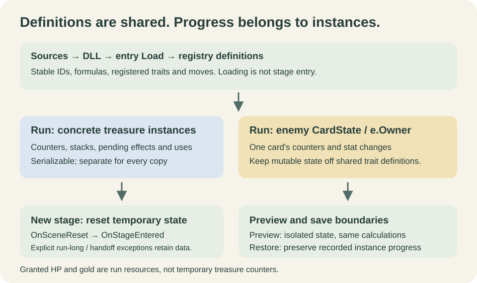

# 定义、运行时实例与重置

[English](../../en/reference/lifecycle.md) · [目录](../README.md)

教程修订 5 · Mod API 1.8.0 · 2026-10-14

本页集中解释状态属于谁，以及什么时候初始化、读取和清空。当前基准 1.8.0；[事件](events.md)与[API 声明](api-surface.md)提供字段细节。

## 1. 创建与加载定义

源码构建生成 DLL。包加载器查清单、执行入口 `Load`，收集内容定义并建立注册表。构造函数确定稳定 ID；加载期不等于游戏某场景的开始。文字 resolver 在内容快照中配置，Mod 不应替换宿主 resolver。

角色定义组合注册的特性与招式；Stage 创建独立场景定义；Adventure 步骤展开为场景列表。定义对象可以被多个局或敌人实例使用，不存某局玩家引用。

## 2. 当前局与具体实例

| 数据 | 归属 | 正确使用 |
| --- | --- | --- |
| 宝物固定公式／品质配置 | 内容定义 | 可重复读取，不作为场景进度 |
| 宝物层数、计数、待用强化 | 具体宝物运行时实例 | 可序列化字段；新场景默认清空 |
| 敌人计数、攻击／防御 delta | `CardState`（`e.Owner`） | 每张卡独立；不写共享 EnemyTraitContent 字段 |
| 玩家 HP、金币等兑现资源 | 当前 `GameState` | 使用 Runtime／核心结算，不按临时宝物字段清零 |
| 自动请求和共享奖励 | 本次事件对象 | 累加后由宿主结算，不作为长期缓存 |

同一 treasure 定义会创建不同 `TreasureState.runtimeEffect`。简单字段可随实例克隆；可变引用数据必须确认独立复制，不能多个实例共用一个 List。没有当前运行上下文时，不靠全局查找 UI 或场景 GameObject 补状态。

## 3. 预览与执行

预览使用隔离状态并调用相同规则。`IsPreview` 区分当前窗口，但不允许另造一套数值公式。不要在预览中改静态状态、共享集合或真实实例，避免鼠标悬停就消耗一次强化。

派生属性必须能重复重算，不累加漂移。基础属性换算不读取其他宝物派生值，避免攻防互转循环。同类百分比统一合并，具体取整见[事件页](events.md)。

## 4. 场景边界与保存恢复

默认新场景重置宝物临时状态，`OnSceneReset()` 清除本类的计数、层数、待用效果；主动使用次数由相应规则恢复到该品质 `MaxUses`。只有明确“本局保留／永久／下场景”等例外才保留必要交接数据。已兑现的资源与固定配置不是临时计数。

整备开始前核心会清理离场的临时生命体系状态；进场奖励在进入新场景结算。进入后才拿到进场宝物，要到下一次进场测试，不把领取时是否立即加盾当证据。

存档恢复需保留当前实例已发生的进度，不无条件把读档当成新场景。新开局从新的定义与实例开始。EnemyTraitContent 无宝物式 OnSceneReset；新敌人卡初始为零进度，旧卡克隆和恢复保存自身字段。

## 5. 作者的最小验证

分别测试两件同宝物、两只同敌人、重复预览、达到上限、换场景、新局和存档恢复；记录状态应该保留还是清空。固定奖励与跨场景检验见[宝物课](../tutorials/treasure.md)，完整清单见[测试总览](../04-testing-and-publishing.md)。
