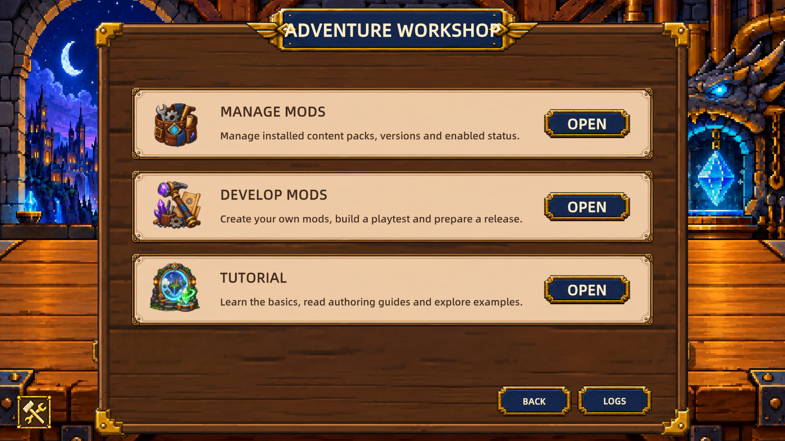

# 运行并修改第一个模组

[English](../../en/tutorials/first-mod.md) · [目录](../README.md)

教程修订 2 · Mod API 1.8.0 · 2026-10-14 · [验证范围](../reference/versions.md)

完成这课后，宝物图鉴里会出现“旅者遗物”，一级说明从 2 点护盾变为 4 点。这个结果证明项目已经构建、安装并加载；实际进场加盾在下一课的固定关卡中验证。

你需要已安装的游戏、一个代码编辑器，以及能在终端运行 `dotnet --version` 的 .NET SDK。无需 Unity 或游戏源码。先完成一个模组，暂时不加图片、音乐或配置。

## 1. 创建工程并确认四个名称

从主菜单左下角的交叉工具按钮进入冒险工坊，打开「开发模组」，点击「新建 C# 项目…」。英文界面依次为 **Adventure Workshop → Develop Mods → New C# Project…**。这课使用包 ID `local.alice.lantern-trail`，显示名“提灯之旅”，作者填自己的名字。如果这个 ID 已存在，选择另一个包 ID，并保留新工程生成的命名空间。



实机英文界面，2026-10-13、API 1.8.0；点击中间 **Develop Mods** 一行的 **Open**。其他语言的布局与入口相同。截图只用于识别教程入口。

在项目行点击“打开源码”。应看到 `package.json`、`source/ModEntry.cs`、`source/*.csproj` 和 `localization`。首次未构建时没有 Mod DLL 是正常状态。

找不到按钮或文件时，看[新建窗口、源码目录和构建结果配图](../reference/visual-walkthrough.md)。

| 名称 | 本课值 | 修改方式 |
| --- | --- | --- |
| 包 ID | `local.alice.lantern-trail` | 与目录、入口特性一致，发布后保持稳定 |
| 命名空间 | `LocalAliceLanternTrailMod` | 保留游戏生成值 |
| 完整入口名 | `LocalAliceLanternTrailMod.ModEntry` | 对应 `package.json.codeEntryPoint` |
| 显示名 | 提灯之旅 | 修改本地化值，不改上述标识 |

`codeAssembly` 应指向 `mod/LocalAliceLanternTrailMod.dll`。这些值区分大小写。其他包 ID 会生成其他入口，不能原样套用此表。详细契约见[入口与注册](../reference/entry.md)。

## 2. 统一入门源码

打开[最小入口与旅者遗物片段](../../../templates/zh-CN/01-entry-and-config.cs.txt)。把内容复制到 `source/ModEntry.cs`。只有包 ID 与本课一致时才能整份替换；否则先把片段的命名空间和 `PackageId` 改成自己生成工程的值，再核对清单。保留生成的 `.csproj` 和 `package.json`。

这个片段注册一件宝物，效果是“进入场景时获得 `BaseValue × level` 护盾”。名称和说明读取游戏已生成的 `content.starter_relic.*` 文本键。默认 `BaseValue` 是 2；说明与执行共用它。原文件名含 `config` 是旧链接，当前片段不注册配置。

较早的游戏脚手架可能含 `shield_per_stage` 配置或 `gameplay.general` 标签。本课替换源码后统一为护盾分类与生命构筑池，兼容 API 的背景见[兼容说明](../reference/compatibility.md)。

## 3. 构建并确认加载

保存文件，回到项目行点击“构建并安装”。成功后在模组管理页确认已启用，完整退出并重启游戏，再打开宝物图鉴。角色筛选选“全部角色”，搜索“旅者遗物”；英文界面搜索 `Wayfarer's Relic`。

应该找到旅者遗物。图鉴默认可能选中最高可用品质，可以用左下方箭头切换；这里切换的是品质，不是等级。首课未提供各品质的不同数值，图鉴各品质的一级说明均为“进入场景时获得 2 点护盾”。这一步不依赖宝箱随机抽取，也不授予宝物。

若没有结果，按[加载失败排查](../troubleshooting.md)检查启用状态、入口和语言；不要先通过增加宝箱权重解决加载问题。

## 4. 修改一次并重新验证

将这一行的 `2` 改成 `4`：

```csharp
public override int BaseValue => 2;
```

保存源码，把 `package.json.version` 从生成的 `0.1.0` 提升到 `0.1.1`（已有其他版本时递增当前版本）。重新构建并安装，完整退出并重启。安装器不接受同一已安装版本下的不同内容；后续每次修改内容并安装前都应递增版本，保持 `packageId` 不变。再次在图鉴查看一级说明，应变成 4 点，各品质均相同。真实运行时仍按 `4 × 等级` 计算；图鉴的品质箭头不用于提升等级。不改中文或英文说明里的 `{0}`，它由共同公式填入。

如果依然是旧数字，先确认编辑的是 `Sources`，再看构建是否成功，最后确认所有游戏进程已退出。同进程“重载”不能证明新的 C# DLL 已执行。

## 验收与下一步

- 首次构建成功，已启用，图鉴能按名称找到宝物。
- 一级数字从 2 变为 4，重新构建和完整重启后才能看到变化。
- 包 ID、内容 ID、入口名和文本键没有随显示文字改名。

继续[制作与测试宝物](treasure.md)。若想先玩到自己的牌场，直接做[固定关卡](stage.md)，再回宝物课添加确定奖励。
