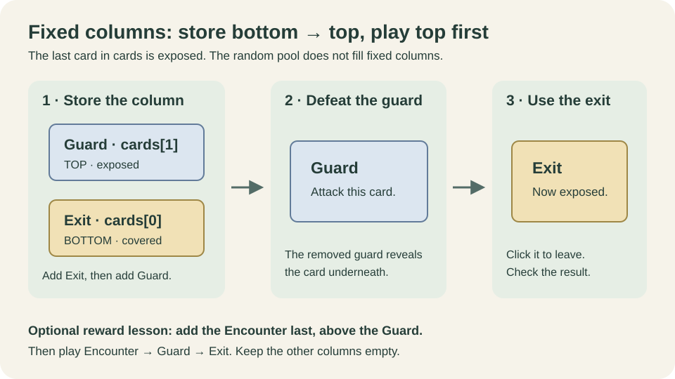

# 制作第一个固定关卡

[English](../../en/tutorials/stage.md) · [目录](../README.md)

教程修订 2 · Mod API 1.8.0 · 2026-10-13 · [验证范围](../reference/versions.md)

目标：关卡选择页出现“林径练习”；进场后第一列只有守卫和其下的出口，其他列为空；击败守卫，再点击出口，冒险胜利。第二次把守卫生命由 4 改为 8，重启后看到新值。

前置：[首个模组](first-mod.md)。这里只增加两个完整内容类，不提供成品冒险包。修改 `source/ModEntry.cs` 并新增 `source/PracticeStage.cs`，无需外部类、图片或音乐。

安装修改后的构建前，按[首课](first-mod.md#4-修改一次并重新验证)递增 `package.json.version`；同一已安装版本不能对应不同内容。

## 1. 增加素材关卡与选择入口

把[固定关卡片段](../../../templates/zh-CN/08-fixed-stage-lab.cs.txt)复制为 `source/PracticeStage.cs`。保留自己的生成命名空间。它包含 `PracticeStage` 与 `PracticeAdventure`，不包含第二个 Mod 入口。

在现有 `ModEntry.Load` 里保留旅者遗物注册，再添加：

```csharp
registrar.AddContents(new PracticeStage(), new PracticeAdventure());
```

`StageContent` 定义牌场，`AdventureContent` 创建关卡选择页入口。只注册 Stage 不足以创建这个入口。固定布局的 guard 直接用公开的 `ContentCards.Enemy` 创建；学习[敌人课](enemy.md)后可改为注册 `EnemyContent` 并调用它的 `CreateCard`。

## 2. 理解代码顺序与点击顺序



`cards` 从底到顶存储，最后一张是明牌。本课先加入出口，再加入守卫，所以玩家先遇见守卫。循环创建正常数量的列，只在第一个列表加牌；空列会保留为空。

`appearancePool` 中保留一个 Exit 模板，便于兼容较早的校验器。当前 C# 校验器在固定布局检查固定列中的出口，在随机布局检查候选池中的出口。因为 `fixedColumns` 非空，运行时只克隆固定牌列，不从随机池补牌；这个池中模板不会变成第二个出口。完整字段约束见[关卡参考](../reference/stages.md)。

## 3. 构建并按玩家动作验证

构建安装，完整退出并重启。在关卡选择页翻页找到“林径练习”，选择唯一难度和符刃猎手。进入后应看到第一列守卫，其余列为空。

点击守卫完成攻击，确认其被击败后明牌变成出口；点击出口，检查胜利结算。不同角色强化可能改变击败所需次数，本课不承诺固定攻击次数。图片留空使用宿主后备表现；这用于检查规则流程，正式发布前再补自己的美术。

若入口不出现，检查 Adventure 是否注册、`IncludeInSelection` 是否为 true；若角色不可选，核对 `availableHeroIds` 和 Stage 的 `allowedCharacterIds`。两处都使用公开稳定 ID `BuiltInCharacterIds.RuneHunter`，不要改成显示名称。

## 4. 改一个可见值

在 `ContentCards.Enemy` 调用中将 `hp: 4` 改成 `hp: 8`，重新构建、完整重启并新开一局。守卫最大生命应变为 8，列顺序与出口数量保持不变。

这一步验证新 DLL 的内容确实进入牌场。只看构建成功或注册数量，不能代替这一步。

## 验收与下一步

- 入口存在，唯一难度和允许角色可选。
- 正常列结构保留，只有第一列非空，守卫先暴露。
- 出口确实可点击，并完成冒险；4→8 的源码变化生效。

用[宝物课的明确奖励](treasure.md)扩展测试，或进入[连接多个场景](adventure.md)。随机牌池、首领、图路线与循环留在[进阶总览](../02-content-creation.md)。
